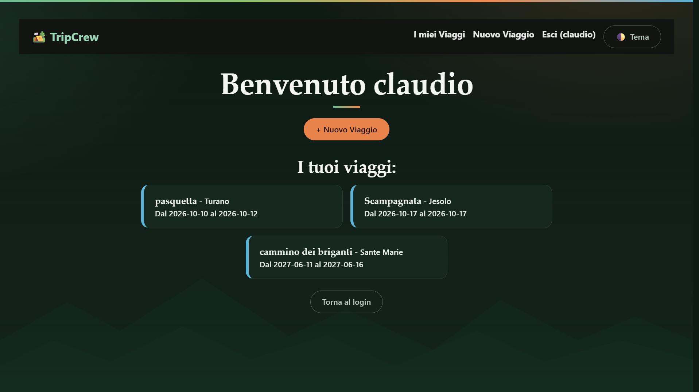
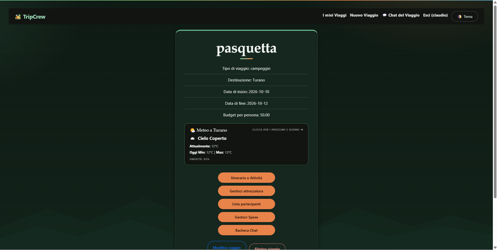
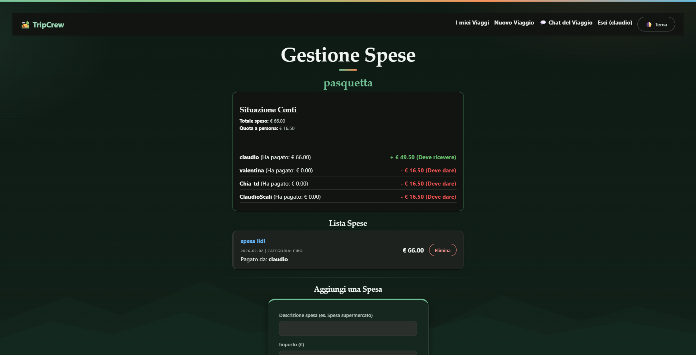

# 🏕️ TripCrew

Web app per organizzare viaggi outdoor di gruppo (campeggio, trekking, escursioni in giornata): attrezzatura, partecipanti, spese, itinerario e chat in un unico posto. Pensata per gruppi di 3-5 persone che devono sapere **chi porta cosa**, **cosa manca** e **quanto ha speso ognuno**.

Progetto finale del corso full stack Python (200 ore).

**Demo online:** https://tripcrew-1ihi.onrender.com


## 📸 Screenshot

### Menu dei viaggi


### Gestione di un viaggio
 

### Checklist dell'attrezzatura
        

### Gestione delle spese
 

## Funzioni

- **Account:** registrazione e login con email e password oppure con Google; l'accesso resta attivo per 30 giorni.
- **Viaggi:** creazione, modifica ed eliminazione (solo il creatore). Ogni tipologia (campeggio, trekking, escursione, hotel) parte da un modello di attrezzatura.
- **Partecipanti:** aggiunta per username o con un **link d'invito** da condividere su WhatsApp.
- **Attrezzatura:** oggetti **di gruppo** (ne basta uno: qualcuno si offre di portarlo e lo vedono tutti) e oggetti **personali** (ognuno ha la sua lista). Stato "preparato" e avanzamento complessivo.
- **Spese:** registrazione di chi ha pagato cosa, quota a persona e bilancio di chi deve dare o ricevere.
- **Itinerario:** programma giorno per giorno con orari, luoghi e costi previsti.
- **Meteo:** condizioni attuali e previsioni a 5 giorni nella pagina del viaggio, più l'icona del meteo previsto accanto a ogni attività (OpenWeatherMap).
- **Traccia GPX:** caricamento di un file GPX e visualizzazione su mappa interattiva con distanza e dislivello.
- **Chat di viaggio** con aggiornamento automatico.
- **Interfaccia:** responsive, tema chiaro/scuro, installabile come app (PWA).

## Tecnologie

| Ambito | Strumenti |
| --- | --- |
| Backend | Python, Flask, Jinja2 |
| Database | MySQL (`mysql-connector-python`), su Aiven in produzione |
| Frontend | HTML, CSS, Bootstrap 5, JavaScript, Leaflet |
| Login | password con hash scrypt (Werkzeug), Google OAuth 2.0 con Authlib |
| API esterne | OpenWeatherMap, OpenStreetMap / OpenTopoMap (mappe) |
| Sicurezza | permessi controllati lato server, protezione CSRF (Flask-WTF), limite ai tentativi di login (Flask-Limiter) |
| Deploy | Render |

## Avvio in locale

Servono Python 3 e un server MySQL.

```bash
git clone https://github.com/TUO-UTENTE/tripcrew.git
cd tripcrew

python -m venv venv
# Windows:      venv\Scripts\activate
# macOS/Linux:  source venv/bin/activate

pip install -r requirements.txt
```

1. **Database.** Crea un database (per esempio `tripcrew`) e importa lo schema:

   ```bash
   mysql -u root -p tripcrew < schema.sql
   ```

2. **Variabili d'ambiente.** Copia `.env.example` in `.env` e compila i valori (vedi tabella sotto).
3. **Avvia l'app:**

   ```bash
   python app.py
   ```

4. Apri **http://127.0.0.1:5000** (usa `127.0.0.1` e non `localhost`: è l'indirizzo registrato per il login con Google).

## Variabili d'ambiente

| Variabile | Descrizione |
| --- | --- |
| `FLASK_SECRET_KEY` | Stringa lunga e casuale per firmare le sessioni |
| `DB_HOST`, `DB_PORT`, `DB_USER`, `DB_PASSWORD`, `DB_NAME` | Connessione a MySQL |
| `OPENWEATHER_API_KEY` | Chiave gratuita di [OpenWeatherMap](https://openweathermap.org/api) |
| `GOOGLE_CLIENT_ID`, `GOOGLE_CLIENT_SECRET` | Credenziali OAuth create in Google Cloud (Google Auth Platform > Client, tipo "Web application") |
| `SESSION_COOKIE_SECURE` | `1` solo online su HTTPS; in locale lascia `0` |

Per il login con Google, tra gli URI di reindirizzamento autorizzati vanno aggiunti `http://127.0.0.1:5000/auth/google/callback` (locale) e l'indirizzo online con `/auth/google/callback`.

## Struttura del progetto

```
app.py              route, accesso al database, login
templates/          pagine HTML (Jinja2)
static/css/         stile (tema chiaro e scuro)
static/             manifest e icone dell'app
schema.sql          struttura del database e modelli di attrezzatura
.env.example        esempio di configurazione
```

## Deploy

L'app è un Web Service su **Render**, collegato al database MySQL su **Aiven**. Le variabili d'ambiente si impostano dalla scheda *Environment* del servizio. Le modifiche allo schema del database vanno eseguite sia in locale sia su Aiven.

## Idee future

- Recupero della password via email (richiede un dominio per l'invio affidabile)
- Modifica dello username e del profilo
- Spese previste e spese effettive
- Quote per giorni di presenza e gestione di auto e passaggi# 🏕️ TripCrew
